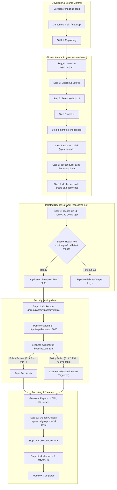
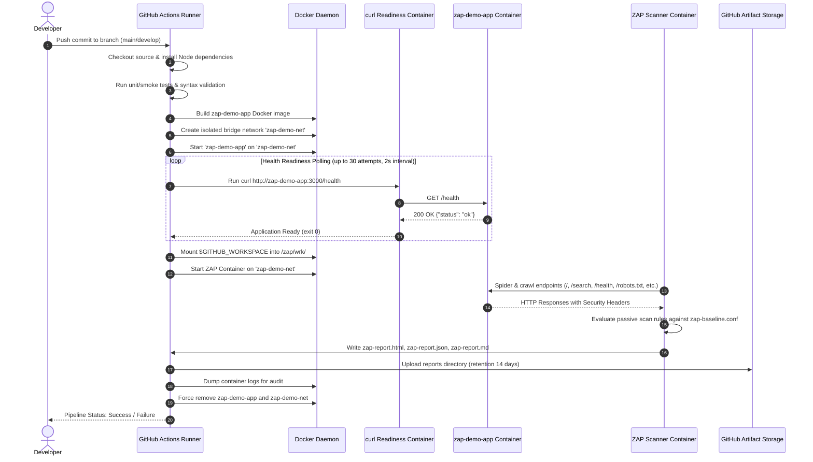

# OWASP ZAP DevSecOps Pipeline Demo (`zap-devsecops-demo`)

> Automated Dynamic Application Security Testing (DAST) CI/CD pipeline integrating OWASP ZAP baseline scanning into GitHub Actions for containerized Node.js applications.

[](https://github.com/MaqsoodRahimanPP/zap-devsecops-demo/actions/workflows/security-pipeline.yml)
[](https://nodejs.org/)
[](https://www.docker.com/)
[](https://www.zaproxy.org/)
[](https://opensource.org/licenses/MIT)

---

## Table of Contents

- [1. Project Overview](#1-project-overview)
  - [Purpose and Motivation](#purpose-and-motivation)
  - [Understanding DAST and OWASP ZAP](#understanding-dast-and-owasp-zap)
  - [Passive Baseline vs. Active Penetration Testing](#passive-baseline-vs-active-penetration-testing)
  - [Intended Audience](#intended-audience)
  - [Current Project Status](#current-project-status)
- [2. Features](#2-features)
  - [Implemented Features](#implemented-features)
  - [Planned Enhancements](#planned-enhancements)
- [3. Technology Stack](#3-technology-stack)
- [4. Architecture & Data Flow](#4-architecture--data-flow)
  - [Architecture Flowchart](#architecture-flowchart)
  - [Execution Sequence Diagram](#execution-sequence-diagram)
- [5. End-to-End Workflow Explanation](#5-end-to-end-workflow-explanation)
- [6. Repository Structure](#6-repository-structure)
- [7. Application Routes & Specifications](#7-application-routes--specifications)
- [8. HTTP Security Headers](#8-http-security-headers)
- [9. OWASP ZAP Baseline Scan Deep Dive](#9-owasp-zap-baseline-scan-deep-dive)
  - [Execution Command Breakdown](#execution-command-breakdown)
  - [Scanner Network Topology](#scanner-network-topology)
  - [The Role and Behavior of `-I`](#the-role-and-behavior-of--i)
- [10. ZAP Policy Configuration (`zap-baseline.conf`)](#10-zap-policy-configuration-zap-baselineconf)
- [11. Local Installation and Setup](#11-local-installation-and-setup)
  - [Prerequisites](#prerequisites)
  - [Step-by-Step PowerShell Guide (Windows)](#step-by-step-powershell-guide-windows)
  - [Step-by-Step Bash Guide (Linux / macOS)](#step-by-step-bash-guide-linux--macos)
- [12. GitHub Actions CI/CD Pipeline](#12-github-actions-cicd-pipeline)
  - [Workflow Definition](#workflow-definition)
  - [Concurrency and Permissions](#concurrency-and-permissions)
- [13. Security Reports and Artifacts](#13-security-reports-and-artifacts)
  - [Report Formats](#report-formats)
  - [Downloading Reports from GitHub Actions](#downloading-reports-from-github-actions)
  - [Alert Interpretation Guide](#alert-interpretation-guide)
- [14. Latest Reported Security Metrics](#14-latest-reported-security-metrics)
- [15. Troubleshooting Guide](#15-troubleshooting-guide)
- [16. Security Limitations & Safety Scope](#16-security-limitations--safety-scope)
- [17. Future Improvements & Roadmap](#17-future-improvements--roadmap)
- [18. Glossary](#18-glossary)
- [19. References and Official Documentation](#19-references-and-official-documentation)

---

## 1. Project Overview

### Purpose and Motivation
Modern software delivery requires testing security early and often—a practice known as **DevSecOps** (shifting security left). Traditional application security reviews often occur late in the development cycle, causing deployment delays and expensive refactoring. 

The `zap-devsecops-demo` repository provides a practical, reproducible demonstration of integrating **Dynamic Application Security Testing (DAST)** directly into an automated CI/CD pipeline. By containerizing a Node.js web application and invoking the official **OWASP ZAP (Zed Attack Proxy)** container during automated builds, security policies are continuously enforced before code merges into protected branches.

### Understanding DAST and OWASP ZAP
- **DAST (Dynamic Application Security Testing)**: Evaluates an application from the outside in while it is running in an environment similar to production. Unlike SAST (Static Application Security Testing), which scans source code files, DAST analyzes actual HTTP request/response exchanges, inspecting returned headers, cookies, redirects, and rendering behaviors.
- **OWASP ZAP (Zed Attack Proxy)**: One of the world's most widely used open-source web application security scanners maintained under the Software Freedom Conservancy.

### Passive Baseline vs. Active Penetration Testing
This project specifically implements the **ZAP Baseline Scan** (`zap-baseline.py`). It is vital to understand the operational difference:
- **ZAP Baseline Scan (Passive)**: Explores the target application using traditional spidering (crawling links, forms, and assets). It inspects the HTTP transactions generated during exploration and evaluates them against passive scanning rules (such as missing anti-clickjacking headers, missing content-type options, loose cookie flags, or information disclosure). **It does not inject malicious attack payloads or modify application data.**
- **Active Penetration Testing (Active Scan)**: Actively attacks endpoints with hundreds of thousands of malicious inputs (SQL injection payloads, blind SSRF probes, buffer overflows, path traversal strings). Active scanning must only be performed against isolated environments with explicit authorization.

> [!NOTE]
> The ZAP Baseline scanner serves as an early-warning regression gate in continuous integration. It does **not** replace a full manual penetration test, code audit, or comprehensive active vulnerability assessment.

### Intended Audience
- **DevSecOps & Security Engineers**: Learning how to integrate containerized DAST gates into GitHub Actions workflows.
- **Software Engineers & Developers**: Understanding how HTTP security headers (Helmet) and output sanitization remediate dynamic scan findings.
- **Cloud & DevOps Architects**: Designing isolated bridge networks for inter-container scanning within ephemeral CI runners.

### Current Project Status
- **Repository State**: Fully operational end-to-end pipeline.
- **Application**: Node.js 24 Alpine container running Express 5 with Helmet security headers, HTML entity escaping on search inputs, and explicit health/bot routes.
- **Automated Pipeline**: GitHub Actions workflow (`Dummy App DevSecOps Pipeline`) executing tests, container build, container startup, health polling, ZAP baseline scanning with custom policy rules, artifact archival, and graceful teardown.

---

## 2. Features

### Implemented Features
- [x] **Lightweight Express Application**: Written with Node.js and Express 5, serving clean HTML interfaces and JSON endpoints.
- [x] **Production Docker Containerization**: Multi-stage style Node 24 Alpine image utilizing `npm ci --omit=dev`, non-root execution (`USER node`), and minimal attack surface.
- [x] **Automated Application Tests**: Native Node test runner (`node --test`) validating package integrity and entry point contracts without third-party test runners.
- [x] **Comprehensive HTTP Security Headers**: Hardened using `helmet` to inject `Content-Security-Policy`, `X-Frame-Options`, `X-Content-Type-Options`, `Strict-Transport-Security`, `Referrer-Policy`, and opener/resource isolation headers.
- [x] **Custom Permissions-Policy**: Injected middleware defining zero-permission restrictions for high-risk browser capabilities (`camera=(), microphone=(), geolocation=()`).
- [x] **Reflected XSS Remediation**: Custom HTML entity escaping (`escapeHtml`) preventing execution of arbitrary user-supplied script tags in search responses.
- [x] **Crawler Discovery Endpoints**: Explicit `/robots.txt` and `/sitemap.xml` routes preventing spidering 404 noise.
- [x] **Containerized ZAP Baseline Automation**: Invoking `ghcr.io/zaproxy/zaproxy:stable` via `zap-baseline.py` on an isolated Docker network.
- [x] **Custom Security Policy (`zap-baseline.conf`)**: Configured to fail the pipeline if critical anti-clickjacking or content-type protection is missing.
- [x] **Multi-Format Reporting**: Automatic simultaneous generation of HTML, JSON, and Markdown reports.
- [x] **Full GitHub Actions CI Pipeline**: Concurrency group controls, automated health check polling using `curlimages/curl`, artifact upload with 14-day retention, container log aggregation, and guaranteed resource cleanup.

### Planned Enhancements
- [ ] Static Application Security Testing (SAST) integration (e.g., SonarQube Cloud / Semgrep).
- [ ] Automated dependency vulnerability scanning via `npm audit` or Snyk.
- [ ] Container image vulnerability analysis using Trivy or Grype.
- [ ] Full active scanning job executed on scheduled runs against an isolated staging environment.

---

## 3. Technology Stack

| Technology | Purpose | Location in Project | Why Needed |
| :--- | :--- | :--- | :--- |
| **Node.js 24** | Application runtime | [package.json](file:///c:/Users/maqso/zap-devsecops-demo/package.json), [Dockerfile](file:///c:/Users/maqso/zap-devsecops-demo/Dockerfile) | Latest active Node LTS providing modern native testing (`node:test`) and check utilities. |
| **Express 5** | HTTP web framework | [app.js](file:///c:/Users/maqso/zap-devsecops-demo/app.js) | Serves endpoints, handles routing, and processes search query parameters. |
| **Helmet 8** | Security header middleware | [app.js](file:///c:/Users/maqso/zap-devsecops-demo/app.js) | Sets vital defense-in-depth HTTP response headers (CSP, X-Frame-Options, nosniff, etc.). |
| **Docker Engine** | Application & tool containerization | [Dockerfile](file:///c:/Users/maqso/zap-devsecops-demo/Dockerfile), [.dockerignore](file:///c:/Users/maqso/zap-devsecops-demo/.dockerignore) | Ensures identical runtime parity locally and in CI without requiring host dependencies. |
| **Docker Bridge Network** | Inter-container communication | Local CLI & CI workflow | Enables the ZAP scanner container to reach the application container via its DNS name (`zap-demo-app`). |
| **OWASP ZAP** | Dynamic application scanner | `ghcr.io/zaproxy/zaproxy:stable` | Performs automated baseline DAST spidering and passive security rule validation. |
| **GitHub Actions** | CI/CD automation engine | [.github/workflows/security-pipeline.yml](file:///c:/Users/maqso/zap-devsecops-demo/.github/workflows/security-pipeline.yml) | Orchestrates tests, build, network provisioning, container scanning, and artifact collection. |
| **curlimages/curl** | Container readiness polling | [.github/workflows/security-pipeline.yml](file:///c:/Users/maqso/zap-devsecops-demo/.github/workflows/security-pipeline.yml) | Lightweight utility polling `/health` inside the isolated network before launching ZAP. |

---

## 4. Architecture & Data Flow

### Architecture Flowchart



### Execution Sequence Diagram



---

## 5. End-to-End Workflow Explanation

The continuous integration pipeline is defined in [.github/workflows/security-pipeline.yml](file:///c:/Users/maqso/zap-devsecops-demo/.github/workflows/security-pipeline.yml). Each step executes in strict sequential order:

| Step # | Actual Workflow Step Name | Tool / File Responsible | What Happens | Why It Is Necessary | Expected Result | What Happens If It Fails |
| :---: | :--- | :--- | :--- | :--- | :--- | :--- |
| **1** | `Checkout source` | `actions/checkout@v4` | Clones the repository into the runner workspace `$GITHUB_WORKSPACE`. | Provides the repository files to the runner environment. | Repository code available at runner workspace root. | Workflow terminates immediately. |
| **2** | `Set up Node.js` | `actions/setup-node@v4` | Provisions Node.js 24 and configures npm package caching based on `package-lock.json`. | Ensures matching runtime engine and optimizes dependency download speed. | Node `v24.x` and npm ready in runner path. | Workflow fails with tool setup error. |
| **3** | `Install dependencies` | `npm ci` | Executes deterministic dependency installation from lockfile. | Prevents dependency skew and ensures clean, repeatable builds. | `node_modules/` created cleanly with zero vulnerability alerts. | Workflow terminates; missing packages prevent tests. |
| **4** | `Run unit and smoke tests` | `npm test` (`node --test`) | Executes [tests/app.test.js](file:///c:/Users/maqso/zap-devsecops-demo/tests/app.test.js) asserting package structure and `/health` route contract. | Verifies application integrity and contract compliance before building containers. | Both test suites pass (`pass 2, fail 0`). | Pipeline fails; broken code is never built into Docker images. |
| **5** | `Validate application syntax` | `npm run build` (`node --check app.js`) | Validates JavaScript syntax without executing server side-effects. | Catches syntax errors and parse bugs early. | Zero syntax errors. | Build halted before containerization. |
| **6** | `Build Docker image` | `docker build` | Builds image tagged `zap-demo-app:${{ github.sha }}` using [Dockerfile](file:///c:/Users/maqso/zap-devsecops-demo/Dockerfile). | Creates an immutable, production-configured container image. | Image tagged and registered in local Docker daemon. | Docker build fails; workflow halts. |
| **7** | `Create isolated Docker network` | `docker network create zap-demo-net` | Provisions an isolated user-defined Docker bridge network. | Allows inter-container DNS resolution between the app and the scanner without exposing host ports. | Bridge network created with unique subnet. | Pipeline fails; containers cannot communicate. |
| **8** | `Start demo application` | `docker run -d` | Launches the container in the background attached to `zap-demo-net`. | Runs the target application so ZAP has a live HTTP server to test. | Container started; returns container ID. | Pipeline fails if container cannot initialize. |
| **9** | `Wait for application readiness` | `curlimages/curl:latest` | Executes a shell loop running curl against `http://zap-demo-app:3000/health` up to 30 times (60s). | Guarantees the server is actively accepting connections before launching ZAP, preventing race conditions. | Prints `"Application is ready"` and exits 0. | Dumps container logs and exits 1, failing the build. |
| **10** | `Create report directory` | `mkdir -p reports` | Creates local directory for scan reports (runs `if: always()`). | Ensures the target mount directory exists before container writes. | Directory `./reports` created or verified. | File output error during scan. |
| **11** | `Run OWASP ZAP Baseline Scan` | `ghcr.io/zaproxy/zaproxy:stable` | Mounts workspace into `/zap/wrk/`, crawls target via DNS name, applies `zap-baseline.conf`, and writes 3 reports. | Executes passive DAST assessment against all exposed endpoints. | Exit 0 (clean) or Exit 1 with `-I` (warnings tolerated); reports written. | Exit 2 if any rule marked `FAIL` in policy is triggered. |
| **12** | `Upload ZAP reports` | `actions/upload-artifact@v4` | Archives the `reports/` directory as an artifact named `zap-security-reports` (`if: always()`). | Preserves audit evidence and downloadable reports for developers. | Artifact zip file published to the workflow run. | Warning issued if no files found; build state preserved. |
| **13** | `Collect container logs` | `docker logs zap-demo-app` | Dumps stdout and stderr of the application container (`if: always()`). | Provides full debugging context if the application crashed or threw unhandled errors. | Container logs printed in the CI console. | Non-fatal step (`|| true`). |
| **14** | `Clean up demo container` | `docker rm -f` & `docker network rm` | Stops and destroys the application container and removes `zap-demo-net` (`if: always()`). | Prevents resource leaks and orphan containers on self-hosted or shared runners. | Clean Docker state. | Non-fatal step (`|| true`). |

---

## 6. Repository Structure

```
zap-devsecops-demo/
├── .github/
│   └── workflows/
│       └── security-pipeline.yml   # Complete GitHub Actions CI/CD pipeline definition
├── reports/
│   ├── zap-report.html             # Full styled HTML ZAP baseline scan report
│   ├── zap-report.json             # Machine-readable JSON alerts and site structure
│   ├── zap-report.md               # GitHub-flavored Markdown scan report
│   └── zap-legacy-report.html      # Baseline report generated under legacy scanner tag
├── tests/
│   └── app.test.js                 # Automated unit and contract tests using node:test
├── .dockerignore                   # Build context exclusion rules for Docker daemon
├── .gitignore                      # Git exclusion rules (node_modules, logs, env files)
├── Dockerfile                      # Production container image definition (node:24-alpine)
├── README.md                       # Comprehensive project documentation
├── app.js                          # Express web application with Helmet and sanitization
├── package-lock.json               # Cryptographically locked dependency tree
├── package.json                    # Project metadata, dependencies, and test scripts
├── zap-baseline.conf               # Custom ZAP policy enforcing FAIL/WARN thresholds
└── zap.yaml                        # ZAP Automation Framework plan generated during runs
```

### Detailed Component Roles

- **[app.js](file:///c:/Users/maqso/zap-devsecops-demo/app.js)**: The core web application. Defines routing, disables server identifying headers (`x-powered-by`), registers Helmet security headers, attaches a strict `Permissions-Policy`, implements `escapeHtml` for input reflection, and serves health and bot discovery routes.
- **[package.json](file:///c:/Users/maqso/zap-devsecops-demo/package.json)** & **[package-lock.json](file:///c:/Users/maqso/zap-devsecops-demo/package-lock.json)**: Declares production runtime dependencies (`express ^5.1.0`, `helmet ^8.3.0`) and test execution scripts (`"test": "node --test"`, `"build": "node --check app.js"`).
- **[Dockerfile](file:///c:/Users/maqso/zap-devsecops-demo/Dockerfile)**: Multi-layer production specification. Uses official `node:24-alpine`, runs `npm ci --omit=dev`, purges npm cache, copies code, enforces least-privilege via `USER node`, and documents port `3000`.
- **[.dockerignore](file:///c:/Users/maqso/zap-devsecops-demo/.dockerignore)**: Prevents accidental inclusion of local `node_modules/`, `reports/`, test files, or credentials into the container build context.
- **[zap-baseline.conf](file:///c:/Users/maqso/zap-devsecops-demo/zap-baseline.conf)**: The security threshold gate. Explicitly instructs ZAP to return an exit code failure if critical security headers are missing.
- **[.github/workflows/security-pipeline.yml](file:///c:/Users/maqso/zap-devsecops-demo/.github/workflows/security-pipeline.yml)**: The automation engine orchestrating the entire lifecycle from commit to report upload.
- **[tests/app.test.js](file:///c:/Users/maqso/zap-devsecops-demo/tests/app.test.js)**: Regression tests verifying that configuration contracts and endpoints are defined properly before any image build is attempted.
- **[reports/](file:///c:/Users/maqso/zap-devsecops-demo/reports)**: Directory holding the artifacts generated by ZAP baseline runs.

---

## 7. Application Routes & Specifications

The application exposed by [app.js](file:///c:/Users/maqso/zap-devsecops-demo/app.js) defines five explicit routes:

| HTTP Method | Route Path | Purpose | Expected Response | Security Considerations & Controls |
| :---: | :--- | :--- | :--- | :--- |
| `GET` | `/` | Application landing page | `200 OK` (HTML) with title, overview text, search input form, and health link. | Protected by Helmet CSP and framing restrictions. Disables `X-Powered-By`. |
| `GET` | `/search?q={query}` | Search query handler | `200 OK` (HTML) displaying `"You searched for: {escaped_query}"`. | **Reflected XSS protection**: Evaluates input through `escapeHtml()` converting `&`, `<`, `>`, `"`, `'` to safe HTML entities. |
| `GET` | `/health` | Service health & liveness contract | `200 OK` (JSON): `{"status":"ok"}`. | **Availability check only**: Confirms the event loop and port binding are functional. Does **not** indicate whether backend services are secure or uncompromised. |
| `GET` | `/robots.txt` | Search engine crawler rules | `200 OK` (Plain text): `User-agent: *\nDisallow: /\n`. | **Advisory only**: `robots.txt` instructs compliant web crawlers not to index pages; it is **never** an authentication or access-control boundary. |
| `GET` | `/sitemap.xml` | XML Site map | `200 OK` (XML) declaring site structure. | Provides crawler discovery targets; eliminates ZAP spider 404 alert noise. |

---

## 8. HTTP Security Headers

Security headers provide critical browser-enforced mitigation against common web application attacks:

| Header Name | Configured Value in Project | Risk Mitigated | How Configured in Source | Verification Command |
| :--- | :--- | :--- | :--- | :--- |
| **`Content-Security-Policy`** | `default-src 'self';base-uri 'self';font-src 'self' https: data:;form-action 'self';frame-ancestors 'self';img-src 'self' data:;object-src 'none';script-src 'self';style-src 'self' https: 'unsafe-inline';upgrade-insecure-requests` | Restricts resource loading; prevents Cross-Site Scripting (XSS), data injection, and malicious iframe embeds. | Injected automatically via `app.use(helmet())`. | `(Invoke-WebRequest http://localhost:3000/).Headers["Content-Security-Policy"]` |
| **`X-Frame-Options`** | `SAMEORIGIN` | Protects users against **Clickjacking** by preventing unauthorized domains from embedding the site within an `<iframe>`. | Configured by `helmet.frameguard({ action: 'sameorigin' })` (Helmet default). | `(Invoke-WebRequest http://localhost:3000/).Headers["X-Frame-Options"]` |
| **`X-Content-Type-Options`** | `nosniff` | Prevents MIME-confusion attacks and browser MIME-sniffing away from the declared `Content-Type`. | Configured by `helmet.noSniff()` (Helmet default). | `(Invoke-WebRequest http://localhost:3000/).Headers["X-Content-Type-Options"]` |
| **`Permissions-Policy`** | `camera=(), microphone=(), geolocation=()` | Blocks access to sensitive browser hardware APIs and device sensors. | Configured via custom middleware in [app.js](file:///c:/Users/maqso/zap-devsecops-demo/app.js) calling `res.setHeader()`. | `(Invoke-WebRequest http://localhost:3000/).Headers["Permissions-Policy"]` |
| **`Strict-Transport-Security`** | `max-age=31536000; includeSubDomains` | Instructs browsers to communicate exclusively over HTTPS for 1 year. | Injected via `helmet.hsts()` (Helmet default). *(Note: Must be evaluated behind TLS in production).* | `(Invoke-WebRequest http://localhost:3000/).Headers["Strict-Transport-Security"]` |
| **`Referrer-Policy`** | `no-referrer` | Prevents leaking sensitive URL paths or tokens in the `Referer` request header. | Configured via `helmet.referrerPolicy()` (Helmet default). | `(Invoke-WebRequest http://localhost:3000/).Headers["Referrer-Policy"]` |
| **`Cross-Origin-Opener-Policy`** | `same-origin` | Isolates the browsing context to prevent Spectre-style side-channel leaks and cross-window attacks. | Injected by Helmet default. | `(Invoke-WebRequest http://localhost:3000/).Headers["Cross-Origin-Opener-Policy"]` |
| **`Cross-Origin-Resource-Policy`**| `same-origin` | Prevents other domains from reading response resources. | Injected by Helmet default. | `(Invoke-WebRequest http://localhost:3000/).Headers["Cross-Origin-Resource-Policy"]` |

> [!IMPORTANT]
> **Defense-in-Depth Principle**: HTTP security headers harden browser execution contexts but do not eliminate underlying server-side vulnerabilities. They must be accompanied by strict input validation, parameterized queries, and output encoding.

---

## 9. OWASP ZAP Baseline Scan Deep Dive

### Execution Command Breakdown
In both local testing and GitHub Actions, the scan is invoked via the official container:

```bash
docker run --rm \
  --network zap-demo-net \
  -v "$GITHUB_WORKSPACE:/zap/wrk/:rw" \
  ghcr.io/zaproxy/zaproxy:stable \
  zap-baseline.py \
  -t http://zap-demo-app:3000 \
  -I \
  -c /zap/wrk/zap-baseline.conf \
  -r /zap/wrk/reports/zap-report.html \
  -J /zap/wrk/reports/zap-report.json \
  -w /zap/wrk/reports/zap-report.md
```

| Flag / Option | Argument Value | Detailed Explanation |
| :--- | :--- | :--- |
| `docker run --rm` | N/A | Runs the container in the foreground and automatically removes its filesystem upon exit. |
| `--network` | `zap-demo-net` | Attaches the scanner container to the shared Docker bridge network where `zap-demo-app` is reachable by name. |
| `-v` | `"${PWD}:/zap/wrk/:rw"` | Mounts the host workspace into the container working directory `/zap/wrk/` with read-write permissions so generated reports persist on the host. |
| `Image` | `ghcr.io/zaproxy/zaproxy:stable` | The official stable ZAP container image maintained on GitHub Packages Container Registry. |
| `Script` | `zap-baseline.py` | The packaged Python automation script that configures and drives ZAP's spidering and passive rules. |
| `-t` | `http://zap-demo-app:3000` | Target URL to spider. Points to the Docker container DNS name on the bridge network. |
| `-I` | *(Flag)* | **Do not fail on warnings**: Instructs ZAP to return exit code `0` even if new `WARN` alerts are detected. |
| `-c` | `/zap/wrk/zap-baseline.conf` | Path to the custom baseline configuration file defining rule actions. |
| `-r` | `/zap/wrk/reports/zap-report.html` | Destination path for the full formatted HTML report. |
| `-J` | `/zap/wrk/reports/zap-report.json` | Destination path for the structured JSON report document. |
| `-w` | `/zap/wrk/reports/zap-report.md` | Destination path for the GitHub Wiki / Markdown report. |

### Scanner Network Topology
Why does ZAP target `http://zap-demo-app:3000` instead of `http://localhost:3000`?
- Inside a Docker container, `localhost` refers to the **scanner container itself**, not the host machine or another container.
- By placing both `zap-demo-app` and the ZAP container on the user-defined bridge network `zap-demo-net`, Docker's embedded DNS resolves the service name `zap-demo-app` directly to the demo container's IP address.

### The Role and Behavior of `-I`
ZAP baseline script return codes:
- **`0`**: Scan completed with zero warnings and zero fails.
- **`1`**: Scan completed with at least one warning (`WARN-NEW`).
- **`2`**: Scan completed with at least one failure (`FAIL-NEW`).
- **`3`**: Fatal scanner initialization or network connection error.

By passing `-I`, ZAP suppresses exit code `1`, preventing non-critical warnings from breaking the CI build. However, **`-I` does NOT suppress `FAIL` rules**. If any rule explicitly defined as `FAIL` in `zap-baseline.conf` is violated, ZAP returns exit code `2`, and the CI build fails as intended.

---

## 10. ZAP Policy Configuration (`zap-baseline.conf`)

The file [zap-baseline.conf](file:///c:/Users/maqso/zap-devsecops-demo/zap-baseline.conf) defines the threshold policy:

```tsv
# ZAP Baseline Scan policy for the training application.
# Fail the scan if either selected security header is missing.

10020	FAIL	(X-Frame-Options Header Not Set)
10021	FAIL	(X-Content-Type-Options Header Missing)
10015	WARN	(Incomplete or No Cache-control and Pragma HTTP Header Set)
```

### Policy Rules Explained

| Rule ID | Rule Name | Action | Reason for Policy Action | Expected CI Behavior |
| :---: | :--- | :---: | :--- | :--- |
| **`10020`** | Anti-clickjacking Header Not Set | **`FAIL`** | Missing `X-Frame-Options` or CSP `frame-ancestors` leaves the application vulnerable to UI redressing and clickjacking. | **Breaks CI (Exit 2)** if any HTML response omits clickjacking protection. |
| **`10021`** | X-Content-Type-Options Missing | **`FAIL`** | Without `nosniff`, browsers may execute uploaded or reflected non-script files as JavaScript. | **Breaks CI (Exit 2)** if any response omits `X-Content-Type-Options: nosniff`. |
| **`10015`** | Re-examine Cache-control Directives | **`WARN`** | Evaluates caching headers to prevent proxies from caching sensitive personal data. | Logged as warning; build continues when running with `-I`. |

### Actions: `FAIL`, `WARN`, `IGNORE`
- **`FAIL`**: Strict enforcement. Any violation raises a `FAIL-NEW` finding and immediately fails the pipeline (Exit Code 2).
- **`WARN`**: Advisory finding. Flags the issue in reports for developer review without blocking deployment (Exit Code 1, suppressed to 0 with `-I`).
- **`IGNORE`**: Suppresses the rule completely. Used when a check is inapplicable or confirmed as a false positive.

> [!WARNING]
> Never downgrade a rule to `IGNORE` merely to achieve a "green" build. Policy exclusions should always require an architectural review and documented security sign-off.

---

## 11. Local Installation and Setup

### Prerequisites
Before running the project locally, ensure you have the following installed:
- **Node.js**: `v24.x` recommended (minimum `v20.x`) — Check: `node -v`
- **npm**: `v10.x` or later — Check: `npm -v`
- **Docker Desktop**: Running with Linux container support — Check: `docker version`
- **Git**: Installed and accessible in your shell — Check: `git --version`

---

### Step-by-Step PowerShell Guide (Windows)

#### 1. Clone and Enter the Repository
```powershell
git clone https://github.com/MaqsoodRahimanPP/zap-devsecops-demo.git
Set-Location zap-devsecops-demo
```

#### 2. Install Dependencies
```powershell
npm ci
```

#### 3. Run Unit and Smoke Tests
```powershell
npm test
npm run build
```

#### 4. Build the Application Docker Image
```powershell
docker build -t zap-demo-app:2.1 .
```

#### 5. Provision the Docker Bridge Network
```powershell
# Create network if it doesn't already exist
if (-not (docker network ls --filter "name=zap-demo-net" -q)) {
    docker network create zap-demo-net
}
```

#### 6. Run the Container
```powershell
# Stop and remove any prior instance
docker rm -f zap-demo-app 2>$null

docker run -d `
  --name zap-demo-app `
  --network zap-demo-net `
  -p 127.0.0.1:3000:3000 `
  zap-demo-app:2.1
```

#### 7. Verify Container Status and Logs
```powershell
docker ps --filter "name=zap-demo-app"
docker logs zap-demo-app
```

#### 8. Verify Application Health and Routes
```powershell
Invoke-RestMethod http://localhost:3000/health
(Invoke-WebRequest http://localhost:3000/).Headers
```

#### 9. Test XSS Sanitization
```powershell
$response = Invoke-WebRequest -Uri "http://localhost:3000/search?q=%3Cscript%3Ealert(1)%3C%2Fscript%3E"
$response.Content
```

#### 10. Pull OWASP ZAP Container and Execute Baseline Scan
```powershell
docker pull ghcr.io/zaproxy/zaproxy:stable

# Ensure reports directory exists
New-Item -ItemType Directory -Force reports

# Run ZAP scan using relative mount syntax
docker run --rm `
  --network zap-demo-net `
  -v "${PWD}:/zap/wrk/:rw" `
  ghcr.io/zaproxy/zaproxy:stable `
  zap-baseline.py `
  -t http://zap-demo-app:3000 `
  -I `
  -c zap-baseline.conf `
  -r reports/zap-report.html `
  -J reports/zap-report.json `
  -w reports/zap-report.md
```

#### 11. Open the Generated Report in Browser
```powershell
Start-Process .\reports\zap-report.html
```

#### 12. Local Teardown and Cleanup
```powershell
docker rm -f zap-demo-app
docker network rm zap-demo-net
```

---

### Step-by-Step Bash Guide (Linux / macOS)

```bash
# 1. Clone and enter repo
git clone https://github.com/MaqsoodRahimanPP/zap-devsecops-demo.git
cd zap-devsecops-demo

# 2. Install and test
npm ci
npm test
npm run build

# 3. Build Docker container
docker build -t zap-demo-app:2.1 .

# 4. Create network and start container
docker network create zap-demo-net || true
docker rm -f zap-demo-app 2>/dev/null || true

docker run -d \
  --name zap-demo-app \
  --network zap-demo-net \
  -p 127.0.0.1:3000:3000 \
  zap-demo-app:2.1

# 5. Verify endpoints
curl -s http://localhost:3000/health
curl -I http://localhost:3000/

# 6. Pull ZAP and execute baseline scan
docker pull ghcr.io/zaproxy/zaproxy:stable
mkdir -p reports

docker run --rm \
  --network zap-demo-net \
  -v "$(pwd):/zap/wrk/:rw" \
  ghcr.io/zaproxy/zaproxy:stable \
  zap-baseline.py \
  -t http://zap-demo-app:3000 \
  -I \
  -c zap-baseline.conf \
  -r reports/zap-report.html \
  -J reports/zap-report.json \
  -w reports/zap-report.md

# 7. Clean up
docker rm -f zap-demo-app
docker network rm zap-demo-net
```

---

## 12. GitHub Actions CI/CD Pipeline

The workflow defined in [.github/workflows/security-pipeline.yml](file:///c:/Users/maqso/zap-devsecops-demo/.github/workflows/security-pipeline.yml) automates testing and scanning on every push.

### Workflow Configuration Highlights
- **Triggers**: Runs automatically on pushes and pull requests targeting `main` and `develop`, as well as on-demand via `workflow_dispatch`.
- **Permissions**: Hardened with least-privilege `permissions: contents: read`.
- **Concurrency Control**: Automatically cancels obsolete in-flight pipeline runs when new commits are pushed to the same branch:
  ```yaml
  concurrency:
    group: zap-demo-${{ github.workflow }}-${{ github.ref }}
    cancel-in-progress: true
  ```
- **Readiness Polling**: Uses `curlimages/curl:latest` inside the Docker network to avoid race conditions:
  ```yaml
  - name: Wait for application readiness
    run: |
      for i in $(seq 1 30); do
        if docker run --rm \
          --network zap-demo-net \
          curlimages/curl:latest \
          --fail --silent \
          http://zap-demo-app:3000/health; then
          echo "Application is ready"
          exit 0
        fi
        sleep 2
      done
      docker logs zap-demo-app
      echo "Application did not become ready"
      exit 1
  ```
- **Cleanup Guarantee**: All cleanup steps use `if: always()` to ensure temporary containers and networks are deleted even if earlier steps fail.

---

## 13. Security Reports and Artifacts

Every scan generates three complementary audit reports in the `reports/` directory:

| Filename | Format | Purpose & Best Use Case |
| :--- | :---: | :--- |
| **`zap-report.html`** | HTML | Human-friendly visual report with formatted tables, color-coded severity badges, issue descriptions, request/response evidence, and solution links. |
| **`zap-report.json`** | JSON | Machine-readable structured dataset. Ideal for ingesting into SIEM tools, DevSecOps dashboards, or custom vulnerability tracking scripts. |
| **`zap-report.md`** | Markdown | Clean markdown suitable for pasting directly into GitHub PR comments, issue trackers, or documentation wikis. |

### Downloading Reports from GitHub Actions
1. Navigate to the repository on GitHub: [https://github.com/MaqsoodRahimanPP/zap-devsecops-demo](https://github.com/MaqsoodRahimanPP/zap-devsecops-demo)
2. Click on the **Actions** tab.
3. Select the latest run of **Dummy App DevSecOps Pipeline**.
4. Scroll to the **Artifacts** section at the bottom of the summary page.
5. Click **`zap-security-reports`** to download the bundled ZIP archive containing the generated HTML, JSON, and Markdown reports.

*(Reports are preserved for **14 days** as declared in `retention-days: 14`).*

### Alert Interpretation Guide
When reviewing a ZAP report:
- **Risk Level**: High (Red), Medium (Orange), Low (Yellow), Informational (Blue).
- **Rule ID**: The numerical identifier corresponding to the passive scan rule (e.g., `10020`).
- **Affected URL**: The exact endpoint where the condition was flagged.
- **Evidence**: The specific header, string, or omission triggering the alert.
- **Solution / Remediation**: Actionable guidance from the OWASP community explaining how to fix the finding.

> [!NOTE]
> **Alert Count vs. True Vulnerabilities**: A single missing configuration (e.g., a missing header) will trigger an alert for *every single URL crawled*. An alert count of 10 does not mean 10 distinct vulnerabilities—it often represents one single configuration change across 10 crawled pages.

---

## 14. Latest Reported Security Metrics

> [!IMPORTANT]
> The metrics below reflect the **latest reported execution results** in this environment. They illustrate the hardening progression and do not constitute an immutable security guarantee. Future scans or updated rule packs may produce different findings.

| Metric | Baseline Scan (Pre-Hardening) | Hardened Scan (`zap-demo-app:2.1`) | Status & Impact |
| :--- | :---: | :---: | :--- |
| **`FAIL-NEW`** | **2** | **0** | **100% Policy Pass Rate** |
| **`WARN-NEW`** | **5** | **3** | Reduced by 40% |
| **`PASS`** | **60** | **64** | +4 Security Rules Passing |
| **Scan Exit Code** | `1` (Violations Found) | `0` (Clean with `-I`) | **CI Security Gate Passed** |

### Policy Rules Resolution Summary:
- **Rule 10020 (Missing Anti-clickjacking Header)**: Resolved via `X-Frame-Options: SAMEORIGIN` and CSP `frame-ancestors 'self'`.
- **Rule 10021 (X-Content-Type-Options Header Missing)**: Resolved via `X-Content-Type-Options: nosniff`.
- **Rule 10038 (Content Security Policy Header Not Set)**: Resolved via Helmet default CSP directives.
- **Rule 10063 (Permissions Policy Header Not Set)**: Resolved via custom middleware defining camera, microphone, and geolocation restrictions.
- **Reflected Input Injection**: Resolved via `escapeHtml()` encoding on `/search`.

---

## 15. Troubleshooting Guide

| Issue / Error Message | Likely Cause | Diagnostic Command | Corrective Action |
| :--- | :--- | :--- | :--- |
| `Cannot connect to the Docker daemon` | Docker Desktop service is stopped or not running. | `docker info` | Start Docker Desktop and wait until the engine is running. |
| `Bind for 0.0.0.0:3000 failed: port is already allocated` | Another local process or container is using port 3000. | `Get-NetTCPConnection -LocalPort 3000` or `docker ps` | Stop the competing process or container (`docker rm -f <id>`). |
| `Application did not become ready` (Timeout) | Container crashed on launch or health route failed to respond in 60s. | `docker logs zap-demo-app` | Inspect container logs for unhandled Node.js exceptions or syntax errors. |
| `I/O error: zap-demo-app: Name or service not known` | Scanner container was not attached to `zap-demo-net`. | `docker network inspect zap-demo-net` | Ensure both containers specify `--network zap-demo-net`. |
| ZAP reports `0 URLs scanned` or scans localhost improperly | Targeted `http://localhost:3000` from inside scanner container. | Inspect scan logs | Use the container name `http://zap-demo-app:3000` as the target. |
| `NoSuchFileException /zap/wrk/...` | Passed absolute `/zap/wrk/...` path to `-r` when ZAP automatically prepends mount path. | Check `-r` option argument | Pass relative paths (e.g. `-r reports/zap-report.html`) when invoking `zap-baseline.py`. |
| `npm ci` fails in CI | Lockfile desynchronized from `package.json`. | `npm run build` | Run `npm install` locally and commit the updated `package-lock.json`. |
| ZAP exits with code `2` | A rule explicitly marked as `FAIL` in `zap-baseline.conf` was triggered. | Check scan console for `FAIL-NEW:` lines | Remediate the flagged vulnerability or verify `zap-baseline.conf` thresholds. |
| GitHub Actions reports artifact missing | Step generating reports failed before reaching artifact upload. | Check step logs in Actions tab | Ensure `mkdir -p reports` and `actions/upload-artifact` use `if: always()`. |

---

## 16. Security Limitations & Safety Scope

- **Training & Educational Scope**: This project is built as a DevSecOps reference architecture. Do not deploy the demo application to public production environments without a real persistence layer, authentication mechanism, and production reverse proxy (e.g., NGINX / Cloudflare).
- **Passive Baseline Limitations**: ZAP Baseline scanning **only inspects passive responses**. It cannot detect:
  - Complex blind SQL injection or NoSQL injection.
  - Authentication bypasses or broken session handling.
  - Broken Object Level Authorization (BOLA / IDOR).
  - Business logic flaws and payment manipulation vulnerabilities.
- **Active Scanning Safeguards**: Active scanning sends thousands of malicious payloads and must **only** be executed against isolated, non-production test targets with explicit written authorization.
- **Secret Management**: Never commit API keys, tokens, or credentials to Git repositories. Utilize GitHub Encrypted Secrets for production credentials.

---

## 17. Future Improvements & Roadmap

```
[Implemented] ────────────────> [Next Iteration] ───────────────> [Future Roadmap]
• Express 5 + Helmet            • npm audit dependency gate      • Trivy container scan
• Docker 24 Alpine Image        • Semgrep / SonarQube SAST       • Automated Slack alerts
• ZAP Baseline in CI            • Dependabot version updates     • Full Active Scan in Staging
• HTML/JSON/MD Artifacts        • Pin Action commit SHAs         • Centralized DefectDojo
```

| Priority | Improvement | Category | Status | Target Description |
| :---: | :--- | :---: | :---: | :--- |
| **P1** | **`npm audit` CI Gate** | SCA | Next | Add step running `npm audit --audit-level=high` to block known vulnerable dependencies. |
| **P1** | **Trivy Container Scanning** | Container Security | Next | Integrate Aqua Security Trivy action to scan Docker layers for OS and library CVEs. |
| **P2** | **SAST Static Analysis** | SAST | Planned | Integrate Semgrep or SonarCloud to analyze JavaScript source code for static weaknesses. |
| **P2** | **GitHub Dependabot** | Supply Chain | Planned | Enable `.github/dependabot.yml` for automated security updates and version PRs. |
| **P3** | **Commit SHA Pinning** | Supply Chain | Planned | Replace GitHub Action tags (e.g. `@v4`) with full commit SHAs to prevent supply chain poisoning. |
| **P3** | **Centralized Vulnerability Management**| Reporting | Future | Export ZAP JSON reports directly to OWASP DefectDojo for aggregated enterprise tracking. |

---

## 18. Glossary

- **CI (Continuous Integration)**: Automating the building and testing of code every time a team member commits changes to version control.
- **CD (Continuous Delivery / Deployment)**: Automatically releasing and deploying validated code changes to staging or production environments.
- **DevSecOps**: Integrating security principles, automated tooling, and compliance gates throughout the entire DevOps software development lifecycle.
- **DAST (Dynamic Application Security Testing)**: Black-box security testing analyzing a running application by sending network requests and evaluating responses.
- **SAST (Static Application Security Testing)**: White-box security testing analyzing source code, byte code, or binaries for vulnerabilities without executing the program.
- **OWASP ZAP (Zed Attack Proxy)**: An open-source web application security testing tool used for automated and manual vulnerability assessment.
- **HTTP Security Headers**: Directives exchanged between the web server and the browser dictating security restrictions (e.g., framing, script sources, caching).
- **Docker Image**: An immutable, executable package containing application code, runtime libraries, environment variables, and configurations.
- **Docker Container**: A lightweight, standalone, isolated runtime instance of a Docker image.
- **Docker Bridge Network**: A software-defined internal network enabling containers to communicate with each other via internal IP addresses and DNS service names.
- **Security Gate**: A threshold condition in a CI/CD pipeline that halts the build if unaccepted security risks are detected.
- **Artifact**: A persistent file or collection of files (reports, binaries, logs) preserved after a CI/CD job finishes.
- **False Positive**: An alert incorrectly flagging a security issue that does not actually exist or pose risk in context.
- **Vulnerability**: A flaw or weakness in application design, implementation, or operation that could be exploited by an adversary.
- **Remediation**: Corrective engineering changes made to eliminate or mitigate an identified security vulnerability.

---

## 19. References and Official Documentation

- **OWASP ZAP Project**: [https://www.zaproxy.org/](https://www.zaproxy.org/)
- **ZAP Docker Baseline Scanning**: [https://www.zaproxy.org/docs/docker/baseline-scan/](https://www.zaproxy.org/docs/docker/baseline-scan/)
- **ZAP GitHub Container Registry (ghcr.io)**: [https://github.com/zaproxy/zaproxy/pkgs/container/zaproxy](https://github.com/zaproxy/zaproxy/pkgs/container/zaproxy)
- **Helmet.js Security Documentation**: [https://helmetjs.github.io/](https://helmetjs.github.io/)
- **Express.js Security Best Practices**: [https://expressjs.com/en/advanced/best-practice-security.html](https://expressjs.com/en/advanced/best-practice-security.html)
- **Docker Documentation**: [https://docs.docker.com/](https://docs.docker.com/)
- **GitHub Actions Documentation**: [https://docs.github.com/en/actions](https://docs.github.com/en/actions)
- **GitHub Actions Artifact Storage**: [https://github.com/actions/upload-artifact](https://github.com/actions/upload-artifact)
- **OWASP Top 10 Web Application Security Risks**: [https://owasp.org/www-project-top-ten/](https://owasp.org/www-project-top-ten/)
- **MDN Web Docs: HTTP Headers**: [https://developer.mozilla.org/en-US/docs/Web/HTTP/Headers](https://developer.mozilla.org/en-US/docs/Web/HTTP/Headers)

---

*Repository maintained by [MaqsoodRahimanPP](https://github.com/MaqsoodRahimanPP). Licensed under the MIT License.*
